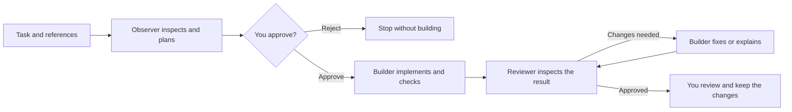

<div align="center">
  
  <h1>Relay</h1>
  <p><strong>Your agents. One shared workflow. You approve the changes.</strong></p>
  <p>A local macOS workspace where Claude Code and Codex inspect, plan, build, and review software together.</p>

  <p>
    <a href="#install-the-macos-app"><strong>Download</strong></a> ·
    <a href="#how-it-works">How it works</a> ·
    <a href="#your-first-task">First task</a> ·
    <a href="#privacy-and-security">Privacy</a> ·
    <a href="#troubleshooting">Troubleshooting</a> ·
    <a href="https://relay-tau-eight.vercel.app/">Website</a>
  </p>

  <p>
    
    
    
    
  </p>
</div>

Relay coordinates the coding agents you already have installed. Give it a task, choose which agent does which job, approve the plan, and follow the build and review handoffs in one window.

- **Local.** Relay runs on your Mac and uses your existing Claude Code and Codex sign-ins. No Relay account, no Relay API key.
- **Approval first.** Nothing is edited until you approve the plan.
- **Your choice of team.** Put Claude Code or Codex in any role, pick models and effort, and save presets.

> **Early prototype · macOS first.** Automated tests and scripted browser checks cover the coordinator and its interfaces. A real Claude observation has been verified; a complete live multi-provider build/review cycle and live image understanding have not yet been verified in the development environment.

## Contents

- [Install the macOS app](#install-the-macos-app)
- [How it works](#how-it-works)
- [What you can do](#what-you-can-do)
- [Your first task](#your-first-task)
- [Task modes](#task-modes)
- [Working with Relay](#working-with-relay) (clarification, approval, teams, images, reports, reviewing changes, recovery, controls)
- [Privacy and security](#privacy-and-security)
- [Run from source](#run-from-source)
- [Development](#development)
- [Troubleshooting](#troubleshooting)
- [Current limits](#current-limits-and-next-steps)
- [License](#license)

## Install the macOS app

**You need:** an Apple silicon Mac on macOS 13 or newer, plus [Claude Code](https://code.claude.com), Codex CLI, or both, installed and signed in. [Git](https://git-scm.com) is required for build tasks.

1. **Download** `Relay-macOS-arm64.dmg` from the [latest release](https://github.com/itsdimash/Relay/releases/latest).
2. **Open the disk image** and drag **Relay** onto the **Applications** shortcut. (If you open Relay from Downloads instead, it offers to move itself to Applications.)
3. **Open it the first time through System Settings.** Relay is not yet signed with an Apple Developer ID or notarized, so macOS blocks the first launch.
   - Double-click **Relay**. When macOS warns about it, click **Done** (do not move it to the Trash).
   - Open **System Settings → Privacy & Security** and scroll to the bottom.
   - Next to the message that Relay was blocked, click **Open Anyway**, then confirm.
   - On macOS 14 and earlier you can instead Control-click Relay, choose **Open**, and confirm.

   You only need to do this once.
4. **Sign in to your agents** in Terminal, skipping any you will not use:

   ```sh
   claude auth login
   codex login
   ```

Relay opens in its own macOS window with the project picker, task composer, conversation history, plan approval, clarification, and handoff controls. Everything runs on your Mac. Click any role in **Your team** to choose its tool, model, and effort.

History and settings for the packaged app live in `~/Library/Application Support/Relay`.

> A `.zip` of the same app is attached to each release too. Prefer to build the app yourself? See [Releasing Relay](docs/RELEASING.md).

### Updates

The app checks this repository's latest GitHub Release when it opens. When a newer version exists, a banner offers **Update now**: Relay downloads the new app, verifies its checksum, replaces itself in Applications, and reopens. Pushing code to GitHub does not update installed apps; publishing a release (a `v*` tag) does. Relay must be in Applications, and it will not update while a task is running.

### Notch panel

Move the pointer to the notch and a small dark panel grows out of it, with icon tabs on both sides of the notch: **Music**, **Notes**, **Deliver** and **Task**. Each tab is its own view. It also opens by itself when a plan or questions need you, and briefly when a task finishes. The **Task** tab keeps showing a finished task for 5 minutes, then goes back to "Relay is idle" (the full history stays in the dashboard).

- **Double-tap the right Command key** (⌘) opens the **full panel** in any app and keeps it open. It adds a fourth tab, **Office**: the pixel-art room where the Observer, Builder and Reviewer pass work to each other. The room only appears here. Double-tap again, press Escape, or choose **View → Show or Hide Notch Panel** to close it. A Command shortcut such as ⌘C does not count.
- **Task:** the step of the task, the latest agent message, and **Approve** / **Reject** when a plan is waiting. A waiting plan opens the full panel and always switches back to the Task view, so you never miss an approval.
- **Task queue:** use **Save to task queue** in the dashboard to prepare another brief while agents work. Each brief keeps its project, team settings, mode, limits, images, and selected-finding context. The dashboard lets you reorder or remove up to 20 waiting tasks. **Next** in Task and Office expands the next brief; **Start task** explicitly starts it after the current worker finishes. Restarting Relay or finishing another task never starts the queue automatically. Build tasks still wait for plan approval. Queue metadata lives in `queue.json`, with private payloads in `queue/`; removed briefs are moved to `queue/removed/`.
- **Recent activity:** expand this in Task or Office to see the latest 12 saved events for the displayed task, with the agent, role, and timestamp. Repeated updates are folded together and raw tool calls are omitted. The activity area scrolls independently so the status and Office usage indicators stay visible.
- **Music:** whatever is playing on your Mac: Apple Music, Spotify, YouTube in Chrome, Yandex Music, anything that appears in Control Center. The view shows the cover, title, artist, a progress bar with the time played and left, and previous, play/pause and next. When a **new track starts**, the notch grows into a small pill with the cover, title, artist and your chosen music animation, then retracts after a few seconds. Move the pointer onto the pill to open the Music view. It reads the system's Now Playing information through the bundled [MediaRemoteAdapter](third_party/mediaremote-adapter/SOURCE.txt) (BSD 3-Clause), which relies on a private Apple interface. If a future macOS update breaks it, music simply does not show and nothing else is affected. No permission prompt is needed.
- **Deliver:** a shelf for files you need to move from one place to another, so you stop copying them by hand. **Drag files toward the notch** (from Finder, or from the Downloads stack): the panel opens by itself on Deliver, and you drop them on it. Later, open the panel (it comes back to the tab you used last), then **drag a row out** into the page, mail or folder where the file is needed, or press **Drag all** to carry every file in one move. To carry only some, **click** a file to select it, **⌘-click** to add or remove one, or **⇧-click** to select a range; dragging any selected file carries them all. Files are never copied: Deliver remembers only where they are (in `deliver.json` in Relay's data folder), so a file you moved or deleted shows greyed out as *missing*. Dropping a row in Finder behaves like dragging the file there yourself (it moves on the same disk, and ⌥ copies it). The **×** on a row takes it off the shelf without touching the file, and **Clear** empties the shelf. Files you moved with the drop (a move in Finder) leave the shelf by themselves. **Auto-clear** also takes copied files off the shelf once they are dropped somewhere (off by default; the choice is kept in `deliver-settings.json`). **Auto-catch** puts each new download from your `~/Downloads` folder on the shelf by itself (off by default). Relay looks at the folder every couple of seconds and takes a file once it has stopped changing, so a download that is still arriving (`.crdownload`, `.download`, `.part`) and hidden files are skipped; files already there when you switch it on, folders, and anything you took off the shelf are left alone, and files that arrive while Relay is closed are not caught. The first time, macOS may ask to let Relay open your Downloads folder; if you said no, the panel tells you where to allow it (System Settings › Privacy & Security › Files & Folders). **Zip** packs the files you picked (or all of them when none is picked, folders included) into one `.zip` that appears on the shelf, ready to drag out as a single file; the originals stay where they are, and the zip, which lives in Relay's data folder, is deleted when you take it off the shelf. The **sliders** button next to it folds out the shelf's options: **Auto-catch**, **Auto-clear**, and **Keep**, which takes items off the shelf by themselves once they have been there for 1 hour, 6 hours, 1 day or 1 week (click it to step through the choices; the files themselves are never deleted, only the shelf entry). The shelf holds up to 100 items.
- **Notes:** quick notes and to-dos. Click the field, type, and press **Enter** to save a note, or **⌘ Enter** to save a to-do you can tick off. The panel stays open while you type, and Escape closes it. Notes are saved in `notes.json` in Relay's data folder.
- **Motion:** while agents work, a soft light in the working agent's colour pours down from the notch, a bright thread runs under the tabs, and the Task tab and the room glow. While music plays, the light takes the colour of the cover, the cover breathes, the music animation plays, and in the Office the agents put on headphones, nod to the beat and send up little notes. Even with the panel closed, the notch itself comes alive: a halo breathes around it and bright sparks run around its edge. While music plays it takes the cover's colour; while agents work it takes the working agent's colour, with three sparks (one per agent, the one with the baton longest). A new track or a new agent taking over sends a ripple of light out. It only appears on Macs with a notch, never takes mouse clicks, and agents take priority over music. Reduced-motion settings turn all of it off. The Music view also shows which app the sound comes from, with its icon.
- **Music animations:** the Music view has its own animation behind the controls, and you choose which one. The styles are deliberately quiet: thin shapes in the cover's colour, nothing flashing. Press **Customize** in the top corner of the Music view (or click the small animation next to the song title) to open the picker, which previews every style live. **In panel** offers **Bars** (a few thin bars, the default), **Line** (one thin line that ripples), **Ripple** (two rings that leave the cover every few beats), **Glow** (one soft light that breathes), **Dots** (a row of dots) or **Off**. **On screen** (only in the Relay app) chooses the light around the notch on your display: **Line** (a thin line on the notch edge, the default), **Halo** (the line with a soft glow), **Sparks** (the halo with small lights circling the notch) or **Off**. The colours come from the cover. Relay cannot hear the music, so the motion is a performance, not a meter: every track gets its own tempo and phrasing (from its title), and everything calms down when you pause. The same style shows beside the notch in the track-change pill. Your choice is remembered. Animations are drawn only while music plays and the panel is visible, and with reduced motion each style shows a single still frame. The drawing code is in `static/js/notch-music-fx.js`; to add a style, add a `draw` (and a small `mini`) function there and list it in `STYLES`.
- **Office:** the full panel's room is larger (the panel grows to about 780 pixels wide) and redrawn in more detail. Its window follows your real time of day (sun, moon, stars, clouds, city lights), a wall clock shows the time, the picture becomes the music level meter while music plays, and a whiteboard fills with checks as the Reviewer works. Each agent has its own desk, monitor and props; the baton glows as work passes between them, and the door sign turns green, red or amber for finished, failed or needs-you. In **Auto mode** a neon AUTO sign flickers on the wall. If you are needed, the Observer walks to the door and calls you.
- **Notifications:** the panel announces what happens with a small animated card that slides in under the notch: a task starting, a plan waiting for approval, a question for you, the plan being approved, a decision needed, a retry countdown, an Auto-mode decision, a failure, and a finished task with a burst of confetti. The panel edge also flashes in the matching colour, and the Task tab breathes while something needs you. The Office reacts too (sparks on a retry, confetti on approval). Reduced-motion settings replace the movement with a plain fade. The native panel size constants changed (`FullWidth` 780, `FullBodyHeight` 312), so rebuild the app to see the larger room.
- **View → Open Notch Panel from Screen Top** turns the hover trigger off and on.
- While it is on, closing the main window leaves Relay running so the panel keeps working; click the Dock icon to bring the window back, or press Command-Q to quit.

**Startup.** Relay starts as a notch app: when it launches, only the notch is active, and the main window (the agent workspace) is not even built until you ask for it. Open it from the **Office** tab or any **Open Relay** button in the panel, from the Dock icon, or from the menu bar item below. The very first start of a new install opens the window once so you can see the app. The four choices are behind the **Startup** button (a power icon) in the window header, next to Language and Appearance; the same four are in the Mac menu bar under **Relay › Startup**:

- **Open Relay at Login** adds Relay to your macOS login items (System Settings › General › Login Items). macOS may ask you to approve it there the first time.
- **Open the Window When Relay Starts** also opens the main window at every start (off by default: notch only). If you turn the notch panel off, the window always opens, because there would be nothing else to see.
- **Hide the Dock Icon While Only the Notch Is Showing** (off by default) removes the Dock icon whenever the window is closed. A small Relay icon appears in the menu bar instead, with **Open Relay** and **Quit Relay**, so you can still get back in and quit. The Dock icon comes back while the window is open.
- **Play an Animation When Relay Starts** (on by default) makes a thin line of light draw itself along the notch from the middle outwards, then a bloom and three rings (one per agent colour) spread out and fade, about two seconds in all, so you can see that Relay has started. It plays even when the notch glow is off. With macOS Reduce Motion it is only a soft fade of the line; on a Mac without a notch nothing plays. Turning the option on plays it once as a preview.

The choices are saved in the app's preferences (`RelayOpenWindowAtLaunch`, `RelayHideDockWhenNotchOnly`). The button only exists in the Mac app; in a browser there is nothing to start.

**More menu.** The **⋯** button at the right end of the tab row (Mac app only) opens two entries: **Open Relay** (the window) and **Quit Relay**. Quit goes through the same path as Command-Q, so a running task is saved first. While a task is running, the first press only asks ("A task is running. Click again to quit."), and the second one quits. Escape closes the menu before it hides the panel.

**Reminders (Notes tab).** Write the time in plain words anywhere in a note and Relay keeps it as a reminder: `call mom in 30 min`, `tomorrow at 9:00 send the report`, `friday at 18:00 football`, `at 5pm`, or in Russian `через полчаса чай`, `завтра в 9 отчёт`, `в пятницу в 18:00`. While you type, the line under the field shows what was understood (`Reminder · Tomorrow 09:00`); the time is cut out of the note and appears as a small badge beside it. When the time comes, the notch opens on the Notes for about 14 seconds with an amber banner, and the note's badge turns grey. A **+10 min** button appears beside it (always for the first hour, on hover after that); each press moves the reminder to ten minutes from now and it goes off again. A reminder that came due while Relay was closed is shown on the next start. The clock button beside the note field does the same without typing: **In 10 min / 30 min / 1 hour / 3 hours**, **Tonight** (18:00, only when it is at least an hour away), **Tomorrow** (09:00) and **Next week** (Monday 09:00), or set a day, an hour and minutes (in steps of five) with the arrows and press **Set**. The chosen time shows as a chip in the field (press it to remove) and is used for the next note you save; a time picked this way is used instead of reading the words. `after 10 min` works like `in 10 min`. A day without a time (`buy milk tomorrow`) stays an ordinary note, and so does anything more than a year away. A lone number counts as a time only after `at` or `в`; `at 5` in the afternoon means 17:00 if that is within three hours, otherwise the next 5:00. Reminders live in `notes.json` (`due`, `reminded`) and are due-checked by the engine (`/api/notch` carries `reminders`), so they survive a restart. Ticking a to-do off cancels its reminder.

**Voice (Notes tab).** Dictate a note instead of typing it: press the microphone button in the note field or hold the **right Option** key anywhere while the notch is open. A quick tap latches the microphone on and a second tap stops it; holding is push-to-talk and stops when you let go. Escape cancels. The small **EN / RU** chip beside the microphone picks the language. The words appear in the field as you speak and run through the same reminder reading (`call mom tomorrow at 9`), so nothing is saved until you press Return, unless you finish with the word **save** (or **save as to-do**), which saves it right away. Recognition runs on the Mac when macOS supports it for the language; a single dictation lasts up to 55 seconds. macOS asks for Speech Recognition and Microphone access the first time; if you decline, the notch shows where to turn them on (System Settings > Privacy & Security). **Voice** in the window's Notch menu turns the microphone button and the Option key off. The native side lives in `packaging/RelayDictation.m` and the microphone entitlement in `packaging/RelayApp.entitlements`, so voice needs a rebuild with `scripts/build_macos_app.sh`.

**Voice commands.** When the field is empty and you say only a command, Relay carries it out instead of writing a note. **Tabs:** `open music`, `show the notes`, `go to files`, `open the office`, `открой заметки`. **Music** (when something is playing): `pause`, `play`, `next song`, `previous track`, `пауза`, `следующий трек`; `pause` while it is already paused presses nothing. **To-do:** `to-do buy milk tomorrow at 9`, `add milk to my to-do list`, `дело: позвонить маме` saves the to-do at once, with its reminder. **The agents:** `ask the agents why the build fails`, `tell the agents to fix the failing tests`, `agents, check the ERP parser`, `Relay, plan the release`, `спроси у агентов почему падает сборка`, `скажи агентам починить тесты`. A request for the agents is never sent straight away: Relay switches to the **Task** page (everything about the agents lives there, not in the notes), the panel grows to its big size, which also leaves room for longer Russian words, and a card opens with your words (editable), the kind of work Relay guessed (**Ask** only looks and answers, **Plan** only makes a plan, **Build** changes the code and reviews it after you approve the plan; a question word such as why, what or check means Ask, `plan` means Plan, anything else Build), and the project (the last one you used, from the projects saved in the Relay window). **Add to queue** (or Enter) puts it in the queue, shows it on the Task page and the panel becomes small again; nothing starts until you press **Start task**, and a build still waits for your approval of its plan. Escape or **Cancel** drops it. A note that merely begins like a command (`open notes about the meeting`) stays a note, and so does anything said while the field already has text. The phrases are read by `static/js/notch-commands.js`.

**Asking an agent by name.** Start the request with a name and only that agent is asked: `Observer, why does the build fail`, `ask the reviewer to check the last changes`, `tell the builder to fix the tests`, `Codex, find the slow query`, `Claude, plan the migration`, `наблюдатель, почему падает сборка`, `попроси разработчика починить тесты`, `спроси у ревьюера …`, `скажи кодексу …`, `клод, объясни …`. The comma may be left out, because speech recognition rarely writes one (`Observer what did you observe` works), as long as what follows is plainly a question or an order; a note that only starts with a name (`Claude is down again`) stays a note. Without a name the whole team is asked, as before. The card shows who was understood in a **Who should do it** menu you can change. Names choose a seat, not a power: the Observer and the Reviewer only look (a request to *fix* something becomes a plan for the Observer and a question for the Reviewer, and the Build button is greyed out for them), and only the Builder changes files, after you approve the plan. When the Reviewer or the Builder is asked to look at something, they take the Observer's read-only seat with their own tool, model, effort and instructions from the team. **Claude** or **Codex** takes the seat that does the work (the Observer's for a question or plan, the Builder's for a build) with that tool, its model and effort going back to the tool's default; the rest of the team is untouched. The team used is the built-in default one, as for every task queued from the notch; if the team cannot be read, nothing is queued. The card opens a wide but short panel (680 pt wide, about as tall as the card), not the big one; a plan to approve or the Office still get the big one.

**Spoken answers.** A task you asked for by voice tells you how it went, out loud, with the Mac's own voices (nothing leaves the Mac): its result when it finishes (the first sentences of the summary, without code, links or markup), `A plan is waiting for your approval`, `The Observer has a few questions`, `The task needs your decision`, or that it stopped with an error. Only tasks that were queued from a spoken request and then started with **Start task** are followed; a task that was already running when Relay opened, or that you started by hand, stays quiet. The voice follows the language of the answer (Cyrillic means Russian, otherwise English), so it needs the Russian voice installed on the Mac (System Settings > Accessibility > Spoken Content). Starting to talk, pressing Escape or the **Stop** button that appears while it speaks silences it; a hidden panel finishes its sentence. In the window's Notch menu, **Say the answers** turns it off and **Say everything** adds tasks started by hand and reminders (`Reminder. Call mom`). The voice is `packaging/RelaySpeech.m`; the choice of what to say is `static/js/notch-speech.js`.

**Apps, typing and Telegram by voice.** Three more things the voice can do on the Mac, all in `packaging/RelayActions.m` (the words are read by `static/js/notch-commands.js`). `open Safari`, `launch Slack`, `открой телеграм`, `запусти хром` open an installed app by its name (common Russian names such as `сафари`, `телеграм`, `настройки` are mapped); if no app has that name, nothing happens except that your words land in the note field, so `open the door` is not lost. `type hello, see you at five` or `напечатай …` / `набери …` first shows the words and the app that was in front on a small card in the Notes tab (**Type into Safari**); only a press on **Type** (or Enter) types them, as keys, into that app, on one line and **never** pressing Return, so nothing is sent or submitted; a cancel (× or Escape) puts the words back into the note field, and if another app came to the front meanwhile, nothing is typed. The first time, macOS asks to allow Relay under System Settings > Privacy & Security > Accessibility; typing stays off until you do, and a rebuilt, ad-hoc signed app may have to be allowed again. `telegram: I will be late`, `write in Telegram that dinner is ready`, `в телеграм: буду через час` open Telegram with the words as a draft (Telegram's documented share link `tg://msg_url?url=…`) and also put them on the clipboard, because not every Telegram shows the words from the link (choose a chat and press ⌘V): you pick the chat and press send yourself, and Relay has no Telegram account, bot or token. The phrases need a verb or `Telegram:` at the start, so a note that merely mentions Telegram stays a note.

**Notch menu (in the Relay window).** The button next to **Startup** chooses what the panel shows. **Tabs** hides or shows **Music**, **Notes**, **Deliver** and **Office**; **Task** is always shown, because a plan waiting for your approval appears there. If you hide the Office, **Open Relay** is still in the Task view and in the **⋯** menu. **Alerts** turns the battery alerts on and off. The choices are kept in the browser storage that the window and the panel share (`relay.notchTabs`, `relay.batteryAlerts`), and the panel follows a change at once. Nothing is lost by hiding a tab: Notes, the Deliver shelf and everything else stay as they were.

**Battery alerts.** The engine reads the battery with `pmset -g batt` (at most every 3 seconds; a Mac without a battery simply has no reading) and the panel says something only when it matters: **Charger connected** (with the charge), **Battery is full**, and **Battery low** at 20% and **Battery very low** at 10% while not charging. It never announces what was already true when Relay started, and each low warning comes once until the battery has been charged again. The module is `static/js/notch-battery.js`; the reading is `relay/battery.py`.

**Translate.** A tab in the notch translates between English, Russian and Kazakh with Gemini. Type or paste text (or press Paste, which reads the clipboard only when you press it), pick EN, RU or KK, press Enter, and Copy the result. The source language is detected; text already in the language you chose is translated into Russian (or English). A long result makes the small panel taller, up to 55% of the screen, and then scrolls; closing the panel clears the page. The first time, the tab asks for a Gemini API key. It is saved in `gemini.key` in the data folder (readable only by you) and never sent back to the page; `GEMINI_API_KEY` works too, and `RELAY_TRANSLATE_MODEL` picks another model (default `gemini-3.5-flash-lite`). Text is sent to Google to be translated, through macOS's own `curl`. The module is `static/js/notch-translate.js`; the request is `relay/translate.py`.

**Translate by voice.** The Translate tab has its own microphone button, like the Notes: hold it to talk, or tap to start and tap again to stop, and what you said replaces the text and is translated into the language picked there (the EN/RU button next to it picks the language you speak). On that tab the right Option key talks to it too. Say it with the right Option key, or after "Hey Relay": "translate this to Russian" opens the Translate tab and translates what is on the clipboard (only because you asked; the Mac may ask you to allow it), "translate good morning to Kazakh" or "how do you say thank you in Russian" translates those words, and "переведи это на английский" works the same in Russian. When answers are spoken, the translation is said aloud too (not Kazakh: the Mac has no voice for it).

**Hey Relay.** Off until you turn it on: Notch menu › Voice › Hey Relay. Then say "Hey Relay" (or "Эй, Релей") anywhere, with no key, and your request: a command ("open music", "translate this to Russian") is carried out, and so is a note ("take a note that I need to go to the canteen after 15 min", "remind me to call mom at 9", "сделай заметку…", "напомни мне…"), which is saved at once without those lead words and with its time as a reminder, anything else lands in the note field and is saved only if you end with "save". The microphone stays on while Relay runs, so the first time macOS asks for the microphone and Speech Recognition. It works only with speech recognition that runs on this Mac (`requiresOnDeviceRecognition`): if that is not available for the language, Relay says so and does not listen. Nothing is recorded or sent anywhere, and the listener waits while you dictate or while Relay speaks, so it never hears itself. It listens in the language picked on the microphone button (EN or RU), and it can mishear an ordinary sentence now and then. The listener is `packaging/RelayWake.m`.
- The panel is a page served by the local engine at `/notch`, so you can also open `http://127.0.0.1:48765/notch` in a browser.

### Usage left

Relay shows how much of your 5-hour and weekly limits is left for each tool, in the dashboard (under the connection badges) and in the notch panel's Office. Claude Code only reports it while answering, so Relay takes the reading from its own Claude tasks and, when none is recent, asks Claude one tiny question (the cheapest model, no tools, an empty folder) at most every 15 minutes. That question counts against your Claude usage, and if your 5-hour window was not running it starts a new one. Set `RELAY_NO_CLAUDE_PROBE=1` to turn it off. Readings are kept between launches. Codex is asked through its app-server about once a minute. Both exist only on subscription sign-ins; with an API key the row stays empty. A reading older than 30 minutes shows its age.

### Provider logos

The Claude and OpenAI (Codex) logos appear in the agent avatars on the Team cards and in the activity feed. They are the files `static/providers/claude.png` and `static/providers/openai.png`. To replace them, put `claude.svg` / `openai.svg` (or new `.png` files) in the same folder; an SVG takes priority over a PNG. If a file is missing, the avatar falls back to the letters "Cl" or "Cx". See `static/providers/README.md`.

### Connect your own accounts

Relay uses the authentication already configured in your installed CLIs. It does not provide shared accounts, ask you to upload credentials, or require a separate Relay API key. Model access, provider configuration, billing, and usage limits remain those of your tools and accounts.

Open **Agent connections** in Relay to check installation and sign-in status. A successful connection check does not guarantee a model request will succeed, and Relay has no combined spending or token cap.

If Relay cannot find an executable, set its path before launching from Terminal:

```sh
export RELAY_CLAUDE="/absolute/path/to/claude"
export RELAY_CODEX="/absolute/path/to/codex"
```

Relay also checks the usual macOS installation locations.

## How it works



| Role | Responsibility |
| --- | --- |
| **Observer** | Inspect source and visual references; identify findings and propose a plan. |
| **Builder** | Implement the approved task, run appropriate checks, and report outcomes or blockers. Handles frontend and backend work. |
| **Reviewer** | Inspect the actual result against the task and acceptance checks; approve it or request evidence-backed fixes. |
| **You** | Define the task, approve the plan, inspect the result, and decide whether to keep it. |

The default team uses Claude as Observer and Reviewer, and Codex as Builder. You can assign the same provider to all three roles, and only the providers needed by the selected task mode must be ready.

## What you can do

- **Inspect without editing.** Get an observation or a plan from the current files, including uncommitted changes.
- **Choose your team.** Assign Claude Code or Codex to each role, select models and effort, add instructions, and save presets.
- **Clarify before approving.** The Observer asks focused questions when key requirements are missing. Your answers refine the plan and never authorize edits.
- **Approve before building.** Review the proposed plan, risks, and verification checks before the Builder starts.
- **Bring visual context.** Pick, drop, or paste screenshots and reference images into tasks and follow-ups.
- **Talk to your agent.** Keep chatting in the same saved chat: ask questions, or tell the agent to change things and it does it right away.
- **Act on findings.** Select issues and turn them into an editable planning or implementation brief with evidence attached.
- **Review the result.** Read an overview, priority labels, next actions, file-by-file diffs, new-file previews, and Builder-reported checks.
- **Recover saved work.** Retry a failed step or explicitly continue interrupted work in the same working copy, preserving completed results and approval records.
- **Keep local history.** Search chats, reopen reports, or delete conversations you no longer need. Optional limits keep only the newest chats or cap disk use.

Relay opens with no conversation selected. Saved chats stay in the sidebar until you choose one.

### Night mode

The moon or sun button in the window header opens **Appearance**: **Light** (the default), **Night** (a dark theme for the main window) or **System** (follows your Mac and switches with it). The choice is saved in the dashboard and applied before the page is drawn, so there is no flash of the wrong theme. In the Mac app the window frame follows it too (title bar, scroll bars and the colour behind the page), and the app remembers it so the window opens in the same theme. The notch panel is always dark. The theme is in `static/appearance.css` (it only overrides colours; the other style sheets are unchanged) and is applied by `static/theme.js`; the menu is `static/js/appearance.js`.

### Languages

The globe button next to the theme button opens **Language**: **Automatic** (English, or Русский when your Mac's language list puts Russian first), **English** or **Русский**. The choice is saved and applies to the dashboard and the notch panel (a change in one reaches the other), and the text changes at once, including chats you already have open; dates and times switch to the language's own format. What you and the agents write (task text, reports, agent messages) is never translated; Relay's own text is, including its status messages in saved chats. English is the source text: `static/i18n.js` is the small engine and `static/i18n-ru.js` is the Russian dictionary (exact sentences plus patterns for text with numbers and names). To fix a Russian phrase, edit its entry in `static/i18n-ru.js`. To add a language, add a dictionary file that calls `relayI18n.register('xx', ...)` and list the code in `static/i18n.js`. Tests fail when a sentence is added to the page or the engine without a Russian text. The Mac menu bar and system notifications are not translated yet.

## Your first task

1. Choose **Add project**, give it a name, select its folder, and save it.
2. Select the project and a [task mode](#task-modes).
3. Describe the desired result and any acceptance criteria. Attach visual references if useful.
4. Open **Configure team** to choose tools, models, effort, and role instructions.
5. Set the time limit and, for builds, the review-round limit. Start the task.
6. For **Build & review**, inspect the proposed plan and approve or reject it.
7. Read the final report and review any file changes before keeping them.

**Remove** in the project selector forgets the saved entry; it does not delete the folder.

**Watch an example** runs a clearly labeled simulation. It does not call agents, spend model usage, or change a project.

## Task modes

| Mode | What runs | Editing | Project requirement |
| --- | --- | --- | --- |
| **Observe only** | Observer inspects and reports current behavior, risks, and findings | Disabled | Any existing folder |
| **Plan only** | Observer proposes steps, affected files, risks, and verification criteria | Disabled | Any existing folder |
| **Build & review** | Observer → clarification if needed → your approval → Builder → Reviewer → fix/review rounds as needed | Builder only, after approval | Any project folder (Git is optional) |

Read-only modes inspect your selected folder directly. They can see staged, unstaged, and untracked files without requiring a commit or stash, and they do not treat those existing edits as changes made by an agent.

Build tasks edit your project folder directly; Git is not required. Just before the Builder starts, Relay records a baseline of the folder's files in a private store inside Relay's data folder, never inside your project. The Changes tab, the complete patch and the Reviewer all compare against that baseline, so uncommitted work you already had is not counted as the Builder's change. The folder's own `.gitignore` is respected. Caches (`node_modules`, `.venv`, `__pycache__`), nested Git repositories, files over 5 MB and top-level folders over 50 MB are left out of the baseline, so changes there are not shown. The Builder is still told not to commit or change Git history.

## Working with Relay

<details>
<summary><strong>Clarify missing details</strong></summary>

For **Plan only** and **Build & review**, the Observer can ask up to five focused questions at a time when important requirements are unclear. Clear tasks go straight to a plan. Questions appear in **A few details before the plan**, with optional suggested answers and a text field for your own answer.

Answer every question and choose **Send answers & update plan**. Relay sends the answers to the read-only Observer, which revises the plan or asks remaining questions. The task timer pauses while waiting for answers. Stop remains available.

**Sending answers never approves edits.** A build still stops at **Awaiting your approval** with the final revised plan. Plan-only tasks finish with a read-only report. Observe-only tasks keep their read-only report behavior; chat messages in a finished chat are different and act immediately.

Questions and submitted answers stay in the chat under **Your clarification answers**, are preserved in follow-ups, and are included in the Builder and Reviewer handoffs. Unsent text is saved in the browser tab's session storage, so you can reload and reopen the waiting chat. A server restart interrupts the task; it does not resume questions or approve work automatically.

</details>

<details>
<summary><strong>Approval before editing</strong></summary>

Every real build task waits at **Awaiting your approval** after observation and any clarification rounds. **Approve & start building** releases the Builder; **Reject plan** stops the task without starting it. Approval covers the proposed implementation and its configured review/fix rounds.

The task's time limit pauses while waiting for this decision, and refreshing preserves the pending plan. Graceful shutdown stops the task and saves its changes. After a crash or forced termination, restart marks unfinished tasks interrupted. Neither path approves or resumes work automatically.

Read-only tasks do not start a Builder and do not require this approval gate. A chat message is different: it goes straight to the Builder and acts immediately.

**Auto mode.** Tick **Auto mode** when you start a Plan-only or Build & review task to let the agents work until it is done while you are away. The Observer is told not to ask questions and to state its assumptions in the plan; the plan approves itself (the Approve step shows "Auto mode approved the plan"); and the Builder and Reviewer keep going until the Reviewer approves. When the Reviewer reports the same findings three rounds in a row, or a review-round limit you set is reached, an agent makes the decision instead of asking you: it either gives the Builder a different approach to try (at a round limit it grants itself two more rounds) or accepts what is there and finishes. It changes approach at most twice per task; after that it finishes and lists what is left under **Open items Auto mode accepted**, the status reads **Finished with open items**, and the findings stay in the Review findings tab. A time limit you set is still a hard stop. If an agent fails (a dropped connection, a usage limit, an invalid answer), Auto mode retries that step up to two more times, waiting 30 seconds and then 2 minutes, and tells the Builder to continue from the files as they are. The timeline shows each retry. When an Auto task finishes, needs your decision, or stops with an error, Relay also shows a macOS notification with a sound; pressing **Stop** yourself does not notify. The notification comes from macOS Script Editor, so if you never see one, allow notifications for Script Editor in System Settings → Notifications, or set `RELAY_NO_NOTIFY=1` to turn them off. Auto mode never pushes or commits in the Build flow (the Builder rule is unchanged), and **Stop** always works. The choice is remembered for your next task.

</details>

<details>
<summary><strong>Team presets, models, and effort</strong></summary>

Each role stores its provider, model, effort, and additional instructions. **Tool default** leaves the corresponding setting to the installed CLI. The model and effort menus show Relay's configured choices; Codex can also use its visible local model cache. Availability still depends on your installed tool, provider settings, and account.

Use **Save preset** to store a named team and **Use team** to apply the current settings. New tasks save their own team configuration, so changing a preset does not rewrite existing tasks. Follow-ups inherit the conversation's Observer settings. Additional instructions do not grant extra tools or editing permissions.

Adding another AI provider requires a new adapter and compatibility tests. The current integrations are Claude Code and Codex CLI.

</details>

<details>
<summary><strong>Images and screenshots</strong></summary>

Use **Attach images**, drop files onto the attachment area or prompt, or paste an image into the prompt. Thumbnails show the selected images, with a Remove button for each one.

- Supported formats: **PNG, JPEG, WebP**. Convert HEIC files first.
- Limits: **four images**, including inherited references, at **4 MB per image**.
- Images are saved with the chat when you send the task, outside your project files.
- Each assigned role receives the references when its provider runs.
- Follow-ups inherit saved images; findings-based tasks copy them into the new task.
- Unsent selections stay in memory. Reselect them after a manual page reload.

Starting a real task sends its images, prompts, and relevant project context to the configured agent providers. Image support and usage limits depend on the selected model and tool.

</details>

<details>
<summary><strong>Reports, follow-ups, and findings</strong></summary>

The conversation shows a compact progress state while agents work and the final result when they finish. Individual tool calls and intermediate messages remain in local logs.

New structured reports include:

- A short overview.
- Findings labeled **Critical**, **High**, **Medium**, or **Low** by the agent.
- Recommended next actions.
- An expandable **Full report & evidence** section with Markdown formatting.

Older reports remain readable. Missing priority ratings are labeled **Unrated** rather than generated afterward.

**Talk to your agent.** Use **Talk to your agent** below a finished real chat. Each message goes to your configured **Builder** model as a conversation turn, with the earlier questions, reports and decisions as context. It answers questions without changing anything, and when you ask it to change, build, fix, run, commit or push something it does it immediately with its editing and command tools, with no plan or approval step and no Reviewer. Just before it starts, Relay records a baseline of the folder, so anything it changes appears in **Changes**; a message that changes nothing leaves earlier changes and their patch alone. Codex-based agents are also given network access in chat so a push you ask for can work. Relay does not manage credentials, and the agent is told to commit or push only when you explicitly ask in that message. Answers stay in the same chat, with earlier reports and build changes preserved. Each answer uses a fresh CLI invocation; this is not a resumed desktop-app session. Very long conversations are rejected with a request for a focused new task instead of silently dropping context.

**Build this plan.** After a Plan-only report, **Build this plan** runs the full Build & review pipeline in the same chat (choosing it is the plan approval, so no second planning pass runs, and the Reviewer checks the result). The plan that gets built is the latest plan plus every question and answer from the chat after it, listed under **Changes and decisions agreed in the conversation after this plan**; those take precedence where they conflict. The Approve step shows exactly that text. The Review findings buttons prefill the chat box instead of starting a new chat. Each build keeps its own patch; earlier patches are saved next to the latest as `changes-before-turn-N.patch`.

**Turn findings into a task.** Open **Review findings**, select the issues to address, then choose **Plan selected** or **Build & review selected**. Relay opens an editable draft with the original project, team, selected evidence, and image references. Review it before pressing Start. A build waits for plan approval (or Auto mode approves it). Changing the project or choosing **Clear** removes the attached finding context.

</details>

<details>
<summary><strong>Review and keep code changes</strong></summary>

The **Changes** tab provides:

- File navigation with modified, added, deleted, and new-file labels.
- Line-numbered diffs with additions and deletions highlighted.
- Saved previews of new text files.
- The latest round's **Builder-reported checks**, distinguished as passed, failed, or not run.
- Expandable Builder reports from earlier rounds.

**Reported checks are claims from the Builder, not tests independently rerun by Relay.** The Reviewer inspects source evidence; it does not serve as a separate test runner. A completed task does not establish that every check passed.

Previews are bounded and show notices for truncation, binary files, and unavailable content. Older tasks without saved per-file previews use their existing patch where possible; their new-file bodies may be unavailable. New build snapshots save a complete `changes.patch`, including added, modified, deleted, and binary files, symlinks, and executable permissions. Ignored files are excluded. Generating the patch does not change the working copy's Git staging area. Older patches may omit new files and are not offered as complete downloads.

**The changes are already in your folder.** To copy them elsewhere, choose **Download complete patch** in **Changes** and, in a checkout that matches the folder as it was before the build, run:

```sh
git apply --check /path/to/relay-<chat-id>.patch
git apply /path/to/relay-<chat-id>.patch
```

Then rerun your checks. If the folder is a Git repository, review the changes with `git diff` and commit them through your normal Git workflow.

**Relay does not automatically merge, commit, or push the result.** Each build keeps its baseline under `baselines/` in Relay's data folder until you delete it.

</details>

<details>
<summary><strong>Recover a failed or interrupted task</strong></summary>

For tasks created with checkpoint support, a **Recover this task** or **Continue interrupted work** panel shows what is saved and which step comes next. Choose the action shown there:

- **Retry review** reruns only the Reviewer against the preserved working copy and saved Builder report. It does not repeat observation or building.
- **Continue build** keeps partial edits, asks the Builder to inspect what already exists, and continues the same round.
- **Return to plan approval** reopens the saved plan for an explicit decision. An unapproved plan stays unapproved.
- **Continue questions** preserves the pending question batch and previous answers; answers still do not authorize edits.
- **Retry observation / plan update** repeats only the failed read-only stage.

Relay checks that the task folder and your project folder still exist and that the saved baseline is intact. It does not reset, recreate, merge, or commit the working copy. A saved completed review can be reused only if its source fingerprint still matches; changed files require another review.

Each recovery attempt gets a fresh time budget using the task's configured limit. The original review-round cap remains in force. Only one task can run, and a recovery cannot start while a previous worker is finishing its saves. **Recovery history** keeps previous errors and attempt outcomes. Provider prompts and results from retries have distinct attempt filenames.

Recovery is always explicit. Restart never starts agents or approves a plan on its own. A rejected plan cannot be resumed. Reaching the review-round limit never grants more rounds by itself: the chat shows **Needs your decision**, lists the open findings, and lets you either review the changes (already in your folder) or choose **Fix the remaining findings** with a number of extra rounds you pick. Older tasks and setup failures without a checkpoint need a new task; their working copies remain available for manual inspection.

A checkpoint records results only after Relay receives them. If a process crashes before a result is saved, that unsaved step may need to run again. Existing files remain available; recovery is a fresh CLI invocation with saved context, not a restored provider session.

</details>

<details>
<summary><strong>Controls, history, and deleting chats</strong></summary>

| Control or action | Behavior |
| --- | --- |
| **Pause handoffs** | Finish the current step, then wait before the next handoff. The task deadline continues. |
| **Stop** | Stop the current process group and prevent later handoffs. Written changes remain available. |
| **Without limit — rounds** | Continue fix/review rounds until approval, failure, Stop, or a configured deadline. |
| **Without limit — time** | Remove Relay's deadline; a configured round limit still applies. |
| Close the window | In source mode, leaves the coordinator running in its terminal. |
| Stop or restart Relay | Quitting or Control+C stops the agent group and waits for task persistence. After a crash, unfinished tasks become interrupted. No automatic resume. |

Unlimited settings do not bypass provider quotas, authentication failures, machine sleep, or process failures. Only one task runs at a time.

Search saved conversations in the sidebar. On smaller screens, use **History** to open the list. **New task** clears the selected conversation and returns to the brief.

**Delete a chat.** Open a chat's **…** menu and choose **Delete chat**, or use that button in a finished chat's activity panel. Running tasks must be stopped first.

Deleting is immediate and permanent: Relay removes the chat's conversation, attachments, prompts, logs and baseline. There is no Trash and no Undo. Your project folder is never touched, and this does not erase the CLIs' own histories.

**Limit how much history is kept.** Open **Storage** in the sidebar to see how much space saved chats use. You can optionally keep only the newest 25 to 250 chats, or keep history under 1, 2 or 5 GB. Relay shows how many chats a limit would delete and asks before deleting them. Limits are off by default; the newest finished chat and any running task are always kept.

</details>

## Privacy and security

### Where your data lives

| Setup | Data folder |
| --- | --- |
| Packaged app | `~/Library/Application Support/Relay` |
| Run from source | `./data` inside the Relay folder |

Set `RELAY_DATA_DIR` to use a different folder. Only one Relay may use a data folder at a time.

| Path inside the data folder | Contents |
| --- | --- |
| `projects.json` | Saved project names and local folder paths |
| `teams.json` | Saved team presets |
| `runs/<chat-id>/state.json` | Conversation turns, status, checkpoints, recovery attempts, reports, findings, approval records, checks, and saved change previews |
| `runs/<chat-id>/attachments/` | Images attached to that chat |
| `runs/<chat-id>/events.jsonl` | Readable activity log (the only copy of the events) |
| `runs/<chat-id>/provider-events.jsonl` | Captured provider output and diagnostics |
| `runs/<chat-id>/*.prompt.txt` | Agent instructions and handoffs |
| `runs/<chat-id>/builder-*.txt` | Builder implementation reports |
| `runs/<chat-id>/changes.patch` | Complete patch of the build's changes |
| `baselines/<task-id>.git/` | Private pre-build baselines of edited folders (older tasks used `workspaces/`) |
| `runs/<chat-id>/summary.json` | Small record (title, status, dates) read at startup instead of the full state |
| `retention.json` | Optional history limits (absent when no limit is chosen) |

Relay's combined history is local. The installed tools may save their own sessions, but Relay does not sync a combined conversation into the Claude or Codex desktop apps.

Runtime data is not encrypted by Relay. The supplied `.gitignore` excludes `data/`, environment files, and generated caches. Do not force-add private logs or workspaces to a public repository; ignore rules do not remove files already tracked by Git.

Avoid moving Relay while a task runs. Existing worktrees and saved records can contain absolute paths, so moving the data folder after creating tasks may require Git worktree repair and path updates.

### Security boundaries

Relay is a single-user local application. It binds to loopback, validates request hosts and origins, and requires a per-process token for mutations. These controls are not user authentication. Keep the server local and use trusted projects.

Observer and Reviewer roles use read-only tools. Codex uses its read-only sandbox for those roles and workspace-write for the Builder. Claude read roles receive Read, Glob, and Grep; its Builder additionally receives Edit, Write, and Bash. Claude's restricted tool configuration is not an OS sandbox equivalent to Codex's.

Relay supplies no permission-bypass flags. Instructions against deployment, publishing, or pushing are not an independently enforced shell-command policy. Project instructions, dependencies, tool configuration, and agent behavior remain part of the trust boundary.

## Run from source

Prefer the code over the packaged app? Relay's backend uses only Python's standard library, so **no `pip install` or `npm install` is required.**

| Requirement | Details |
| --- | --- |
| Python | 3.10 or newer |
| Git | Required for build tasks and the repository-based test suite |
| Agent tools | Claude Code, Codex CLI, or both, installed and signed in for the roles you choose |
| Operating system | macOS is the primary environment. The backend requires POSIX process groups and file locking; Linux is not yet validated and Windows is unsupported. |
| Node.js 18+ and npm | Optional, for the convenience scripts and frontend checks |

Clone the repository, open a terminal **inside the Relay folder**, sign in to your agents (`claude auth login`, `codex login`), and start Relay:

```sh
git clone https://github.com/itsdimash/Relay.git
cd Relay
python3 server.py --open
```

The dashboard opens at [http://127.0.0.1:8765](http://127.0.0.1:8765). Keep the terminal running; press **Control+C** to stop the server. On macOS you can also double-click `Start.command`, and `npm start` launches the same server.

For another port, use `python3 server.py --port 8766 --open`. Changing the port does not bypass the data-folder lock.

## Development

For automatic reload:

```sh
python3 dev.py --open
# or
npm run dev -- --open
```

Python source changes restart the backend after a short debounce, and static asset changes refresh the browser. Reloads wait while a task is active; browser reload also waits while unsent image selections exist. Draft text, mode, limits, and selected chat are retained across automatic refresh; unsaved dialog edits are not. Stop any normal server before switching to development mode. Changes to `dev.py` itself require restarting the development command.

Run the tests:

```sh
python3 -m unittest discover -s tests -v
# Equivalent convenience command:
npm test
```

Optional frontend syntax checks:

```sh
node --check static/app.js
# Also check any changed module under static/js/
node --check static/markdown.js
node --check static/review.js
```

The tests use temporary files and repositories and fake provider processes rather than paid model calls. Node-based renderer tests are skipped if Node.js is unavailable. They cover workflow behavior, plan approval, read-only modes, persistence, image inputs, diff capture, Markdown escaping, and HTTP protections; they do not establish full live-provider compatibility.

Relay uses Python's `ThreadingHTTPServer`, not ASGI. `uvicorn server:app --reload` is not supported.

### Building the macOS app

```sh
scripts/setup_macos_packaging.sh
scripts/build_macos_app.sh
open dist/Relay.app
```

This produces an ad-hoc-signed Apple-silicon build for local testing. See [Releasing Relay](docs/RELEASING.md) for signing, notarization, and publishing.

### Project structure

```text
server.py                  CLI launcher; composes and starts the backend
dev.py                     Development reload supervisor
relay/                     Backend modules and application composition
static/                    Dashboard: HTML, styles (brand.css), fonts, report renderers, icons
static/app.js              Frontend startup and feature wiring
static/theme.js            Applies the saved Light / Night / System theme before the first paint
static/appearance.css      The Appearance menu and the Night theme (colour overrides only)
static/i18n.js             Language engine: translates the page's text as it is built and as it changes
static/i18n-ru.js          Russian dictionary (exact sentences and patterns)
static/js/                 Notifications, history, projects, teams, attachments, tasks, and shared helpers
packaging/                 Native macOS app shell: window, notch panel, engine launcher, Info.plist, entitlements
scripts/                   macOS app build, disk image (make_dmg.sh) and icon scripts
dist/                      Packaged app output (Relay-macOS-arm64.zip)
tests/                     Workflow, HTTP, development, distribution, and rendering tests
docs/ARCHITECTURE.md       Architecture and implementation details
docs/RELEASING.md          Building, signing, and publishing the macOS app
CONTRIBUTING.md            Contribution and verification guide
Start.command              macOS launcher for source mode
package.json               Optional npm convenience scripts
data/                      Private runtime data in source mode; ignored by Git
```

See [Architecture](docs/ARCHITECTURE.md) for implementation details and [Contributing](CONTRIBUTING.md) before proposing changes.

## Troubleshooting

| Problem | What to do |
| --- | --- |
| macOS says Relay "can't be opened" or "can't be verified" | Relay is not notarized yet. Click **Done**, then open **System Settings → Privacy & Security** and click **Open Anyway** next to the Relay message. |
| Relay asks to move itself to Applications | Choose **Move to Applications**. It copies itself, then reopens from there. Choose **Don't ask again** to skip it. |
| Relay does not run on my Mac | The packaged app needs an Apple silicon Mac on macOS 13 or newer. On Intel Macs, [run from source](#run-from-source). |
| Agent needs sign-in | Run the relevant login command in Terminal, then choose **Refresh connections**. |
| Relay cannot find `claude` or `codex` | Set `RELAY_CLAUDE` or `RELAY_CODEX` to the absolute path. When launching the packaged app from Finder, make sure the CLI is installed in a standard location. |
| Requested model fails | Check the installed CLI's supported models, configuration, and account access; try **Tool default**. |
| Changes tab is missing a file | The baseline leaves out caches, nested Git repositories, files over 5 MB and top-level folders over 50 MB, so changes there are not listed. Check the event log for the excluded items. |
| Codex cannot start inside another agent's sandbox | Launch Relay yourself from Terminal, `Start.command`, or the app. |
| Relay is already running | Use the existing instance or quit it. Changing ports does not bypass the data-folder lock. |
| Port is occupied (source mode) | Choose another port with `--port 8766`. |
| Build appears to be waiting | Open the chat: the Observer may need answers, or the final plan may be awaiting approval. |
| Updated interface behaves incorrectly (source mode) | Restart the server after backend changes and refresh the page, or use development mode. |
| Image is rejected | Use PNG, JPEG, or WebP under 4 MB; convert HEIC first. Inherited images count toward the four-image limit. |
| Task was interrupted | Open it and use the recovery action when available. Otherwise inspect the preserved working copy and start a new task. Nothing resumes automatically. |

Still stuck? [Open an issue](https://github.com/itsdimash/Relay/issues) with your macOS version, how you launched Relay, and the relevant lines from the chat's `events.jsonl`. Remove anything private first.

## Current limits and next steps

- No automatic recovery, provider-session resumption, or checkpoint migration for legacy tasks.
- No independent Verifier role or enforced browser visual check for frontend work.
- No automatic merge, provider quota tracking, or combined spending cap.
- History limits are opt-in and apply by chat count or total size, not by age.
- No hosted multi-user deployment, Windows support, or Intel build of the packaged app.
- No signed or notarized release, and no automatic updates, yet.

Before a stable release, verify complete live workflows with supported provider versions, including images, and record the environment and results.

## License

A distribution license has not been selected, and no `LICENSE` file is included yet. Until one is added, all rights are reserved by the author.

## Integration references

- [Codex non-interactive mode](https://learn.chatgpt.com/docs/non-interactive-mode)
- [Codex image inputs](https://learn.chatgpt.com/docs/image-inputs?surface=cli)
- [Claude Code programmatic usage](https://code.claude.com/docs/en/headless)
- [Claude image input through streaming messages](https://code.claude.com/docs/en/agent-sdk/streaming-vs-single-mode)

## Companion for the original Codex and Claude desktop apps

Open the full notch panel (double-tap right Command), choose **Office**, then **Codex app** or **Claude app**. Continue giving tasks in the original apps. Relay discovers their local sessions, shows the latest observed activity and account usage readings, and animates the Office. There is no task form or agent launcher in these views. Relay never starts, resumes, interrupts, or sends a prompt to an external app session.

Local session discovery works immediately on supported macOS app versions. It reads Codex's local session index and bounded transcript suffixes, plus metadata for sessions in Claude Desktop's **Code** tab. Ordinary Claude Chat, Cowork, cloud-only sessions, other computers, and unsupported metadata versions are outside this first integration. Old or incomplete signals show **Last observed**, never a fabricated running state. These app-owned file formats may change.

For live activity and supported approval buttons, click **Enable live connection** in each app view. Relay adds its lifecycle hooks to that provider's user settings, preserving other settings and hooks and keeping an exact backup in Relay's data folder. Start a new original-app session to load the connection. Codex requires normal review/trust of the exact Relay hooks with `/hooks`; Relay does not bypass that review. **Disconnect live updates** removes only Relay's own hook entries. Provider-managed policies still apply.

While an original app's supported permission hook is waiting, Relay shows **Approve once**, **Reject**, and **Answer in app**. Decisions go back to that exact pending hook. **Answer in app**, timeout (two minutes), Relay shutdown, or loss of the connection returns no decision, leaving approval to the original app's normal flow. Requests cleared by a matching tool result or turn end cannot be approved afterward. Unsupported prompts, including some Claude network approvals, stay in the original app; a notification hook can direct you there.

Usage comes from observed Codex session rate-limit events and Claude's built-in read-only JSON `/usage` report, with dated desktop history as a fallback. This makes no model requests. Usage is account-wide rather than task progress; missing values remain unknown. Claude readings older than two minutes are shown as **Out of date** rather than current percentages. Provider-reported reset labels are retained. An expired window needs a new reading rather than being assumed 100% available.

Session information and pending decisions stay on this Mac. Relay keeps no copied external transcripts or prompt history. The localhost bridge uses a private per-run token stored in Relay-owned files; credentials and hook tokens are never returned to the Office UI. Original app session files and databases are opened read-only.

The Office usage meters default to **5h**. Choose **Weekly** beside **Limits** to display the weekly window instead. The percentage, meter colour, and reset tooltip all use the selected period; Relay remembers the choice. A missing 5-hour reading never falls back silently to weekly.

The Office app-session list only includes tasks with activity in the last **20 minutes**. This rolling window uses the latest app or live-hook activity, and old sessions disappear automatically, including completed tasks. If nothing is recent, the view says there has been no activity in the last 20 minutes.

When Office opens, it automatically selects the highest-priority active work: **Relay Team → Claude Code → Codex**. Waiting approvals count as active work; a paused Relay team does not. Automatic selection follows activity changes until you manually choose an app or session. Your manual choice stays in place while Office is open, and the priority is applied again next time you open it.

Claude's native usage-history cache can stop updating while Cowork keeps consuming quota. Relay refreshes through the built-in status command rather than depending on that paused cache. It retains observation time and source; restarting Relay or polling the same old cache never makes a stale reading fresh. The existing Claude CLI must support the JSON usage report and be signed into the intended subscription; unsupported versions and API-key-only accounts may have no plan-quota reading.

Claude quota refresh now uses its official built-in `claude -p /usage --output-format json` report, once per minute. This is a local status command, not a model prompt: Relay accepts only `local_command: "usage"`, `num_turns: 0`, and `total_cost_usd: 0`. Claude manages its own sign-in; Relay does not read credentials. The command runs in an empty temporary folder with project tools/settings/MCP servers disabled. All-model weekly and five-hour **used** percentages are converted once to **left** percentages, so 44%/74% used becomes 56%/26% left. The local desktop history is only a dated fallback. Failures back off for two minutes; stale readings are not shown as current. CLI versions without the built-in JSON usage report produce an unavailable reading, never a model-generated estimate.
